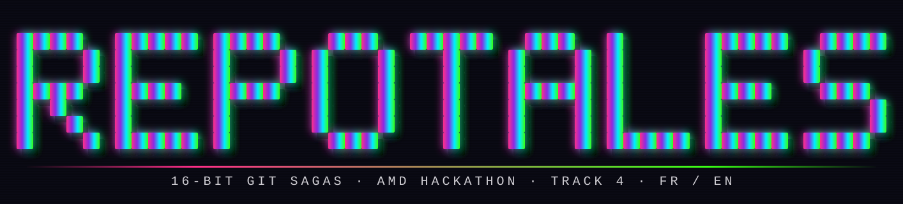
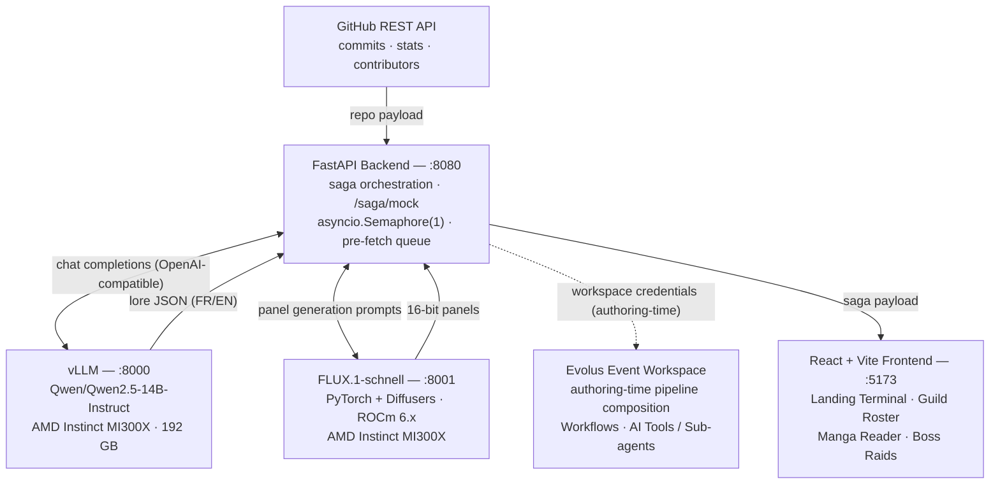

<div align="center">



# REPOTALES

### *Transforming Git Repositories into Interactive 16-bit RPG Sagas*


**AMD Developer Hackathon: ACT III — Track 4** · 100% Self-Hosted Open-Weights AI · FR / EN

</div>

---

## What is RepoTales?

RepoTales is an AI-powered interactive storytelling engine that converts any GitHub repository's commit history, contributors, and most turbulent moments into a playable 16-bit retro manga and RPG boss battle. Paste a repository URL on the landing terminal, and the engine ingests the repository's real Git metrics, rewrites them as an RPG narrative, illustrates each chapter with deterministic pixel-art panels, and throws you into a turn-based raid against the bug that haunts the codebase.

The mapping is systematic, not cosmetic: every gameplay element is derived from actual repository data, so two different repositories always produce two different sagas.

| Git reality | RepoTales legend |
|---|---|
| Contributors | Playable hero cards (HP / ATK / DEF stats derived from commits, PRs, streaks) |
| Commit counts & streaks | Levels, EXP, and guild progression |
| Commit history, merge messages & incident-shaped commits | Manga chapters and panel sequences |
| The worst incident in the log | The Boss — a turn-based raid encounter |
| Saga chapters | Quest log progression |

Everything runs on self-hosted open-weights models serving from AMD Instinct MI300X accelerators: no third-party closed AI service touches the pipeline.

## Hackathon Compliance Matrix

| # | Requirement | How RepoTales complies | Documented in |
|---|---|---|---|
| 1 | Built within the Evolus Event Workspace | The agent pipeline was authored and iterated inside the official Evolus Event Workspace (`app.evolus.ai`) | [Evolus Platform Integration](#evolus-platform--api-integration-requirements-1-3--4) |
| 2 | AMD hardware + BYOM inference | `Qwen2.5-14B-Instruct` (text) and `FLUX.1-schnell` (visuals), both self-hosted on AMD Instinct MI300X via vLLM and ROCm | [AMD Hardware & BYOM](#amd-hardware--byom-integration-requirement-2) |
| 3 | Use of Evolus building blocks | Pipeline authoring, prompt iteration, and lore / character-card structuring were composed in the Evolus Event Workspace; the deployment keeps workspace credentials as configuration hooks | [Evolus Platform Integration](#evolus-platform--api-integration-requirements-1-3--4) |
| 4 | API connectivity | Runtime traffic uses the GitHub REST API, the OpenAI-compatible vLLM chat endpoint, and the FLUX `POST /generate-image` API, unified behind a FastAPI service layer; the frontend consumes one REST contract | [Evolus Platform Integration](#evolus-platform--api-integration-requirements-1-3--4) / [Architecture](#system-architecture) |
| 5 | Containerized, judge-ready setup | One command launch: `docker compose up --build`, with a fully optional `.env` and an offline demo mode (`/saga/mock`) | [Quickstart](#quickstart--judge-setup-requirement-5) |

## The Game Loop

RepoTales plays as four screens, arcade-cabinet style:

1. **Landing Terminal — `INSERT COIN ▸ START SAGA`** — a CRT boot screen where the player pastes any GitHub repository URL (validated live) and powers the machine on.
2. **Guild Roster** — the repository's contributors appear as RPG hero cards (rarity border, segmented HP / ATK / DEF gauges, commit-derived stats) above a guild-wide XP bar.
3. **Manga Reader** — the repository's history becomes a paper-textured 16-bit manga, page by page, complete with speech bubbles, tilted SFX lettering, and Game Boy-style navigation (D-pad, SELECT / START).
4. **Boss Raid** — the saga's archvillain interrupts the reading with a screen-shaking WARNING: a turn-based combat modal where each move carries an AP rating (2-AP moves land criticals) and every hit depletes a segmented boss HP gauge in real time.

The live demo saga served by `GET /saga/mock` is **RepoTales: The Saga of the Broken Pipeline** — four chapters following Aria Nakamura and the 3:00 AM production incident. The design-reference dataset embedded in the components is **CH.3 — LE KRAKEN DU MERGE**, a three-panel excerpt climaxing in the raid against **PRODUCTION OUTAGE LV.99** (HP 6500/10000, SIG `0xDEADBEEF`).

## AMD Hardware & BYOM Integration (Requirement 2)

RepoTales is a strict **BYOM (Bring Your Own Model)** architecture: every inference call targets a model endpoint we own and operate, referenced purely by URL. Both endpoints are served from an **AMD Instinct MI300X** accelerator (192 GB HBM3 VRAM).

| Role | Model | Serving stack | Endpoint |
|---|---|---|---|
| Main agent — lore, chapter breakdown, dialogues, boss design, FR/EN captions | `Qwen/Qwen2.5-14B-Instruct` | **vLLM**, OpenAI-compatible API | `http://129.212.191.240:8000/v1` |
| Visual inference — 16-bit manga panels, hero sprites, boss art | `FLUX.1-schnell` | PyTorch + Diffusers, **ROCm 6.x** acceleration | `http://129.212.191.240:8001` (custom `POST /generate-image`) |

Why this stack:

- **One accelerator, two workloads.** The MI300X's 192 GB of VRAM keeps both the 14B language model and the FLUX.1 image model resident simultaneously, so the pipeline alternates between text and image generation with zero model-swap latency.- **ROCm-native image generation.** FLUX.1-schnell runs through PyTorch / Diffusers on ROCm 6.x — no CUDA anywhere in the visual path.
- **Sovereignty by construction.** 100% self-hosted open-weights inference on AMD cloud infrastructure. Both model families are Apache-2.0 licensed, and repository code ingested from GitHub never transits any third-party closed AI service.
- **Swap-friendly.** Changing the main agent model is a one-line `.env` edit (`VLLM_MODEL=...` or its backend alias `AMD_MODEL_NAME=...`); no application code changes, which is the essence of BYOM.

## Evolus Platform & API Integration (Requirements 1, 3 & 4)

RepoTales was built within the official **Evolus Event Workspace** (`app.evolus.ai`), which served as the authoring and orchestration home for the agent pipeline during the hackathon.

| Evolus building block | Role in RepoTales |
|---|---|
| **Evolus Event Workspace** | Pipeline authoring, prompt iteration, and workflow composition during ACT III |
| **Evolus Workflows** | Used during authoring to sequence the pipeline stages (repo ingestion → lore draft → chapter breakdown → boss design); `EVOLUS_WORKSPACE_ID` / `EVOLUS_API_KEY` are passed through Compose as deployment hooks |
| **Evolus AI Tools / Sub-agents** | Used during authoring for **lore structuring** (commits into acts, chapters, panels) and **character card generation** (contributors into RPG stat sheets) |
| **OpenAI-compatible endpoints** | The local vLLM agent speaks the OpenAI chat-completions protocol, so orchestration prompts and model calls share one interface |

Connectivity summary: at runtime the FastAPI backend communicates with the **GitHub REST API**, with the story model through its **OpenAI-compatible chat-completions endpoint**, and with FLUX through its own **`POST /generate-image`** JSON API. The React frontend consumes a single REST contract exposed by the backend. Evolus workspace credentials are forwarded by Compose for deployments that attach workspace-side workflows; the current runtime does not issue Evolus API calls itself.

## Key Features & Highlights

### Deterministic Visuals — SHA-256 Seeds

Every image URL is built from a SHA-256-derived seed (`deterministic_seed()` in `backend/services/image_service.py`), so the artwork for a given repository is reproducible across runs and backend restarts:

- **Avatars** seed on `(repo key, "avatar", character_id)`.
- **Boss sprite** seeds on `(repo key, "boss", "sprite")`.
- **Each panel** seeds on `(repo key, scope, "panel", position, hero_id)`, where `scope` is the chapter index (or `boss`) and `position` is the panel's index. Every panel therefore has its own stable seed, while the same repository always regenerates the same page.

Visual continuity across different seeds comes from the prompt layer: FLUX has no memory between calls, so `canonical_appearance()` derives a fixed hair / eye / outfit description from the character id and injects it into every portrait, chapter panel, and boss-fight prompt featuring that character. Combined with the fixed "Neon Cartridge" palette and `image-rendering: pixelated` post-processing, the output always reads as authentic 16-bit console art.

### Interactive 8-bit Audio — `soundService.js`

The entire soundtrack is synthesized at runtime by a Web Audio API chiptune engine: oscillator-based BGM plus **8 retro SFX** (`insertCoin`, `click`, `pageFlip`, `alarm`, `attack`, `critical`, `victory`, `error`). There are no audio files in the repository — zero heavy assets, a payload measured in kilobytes of code instead of megabytes of sound, and instant playback with no loading state.

### Interactive Boss Raids

The boss modal is real turn-based combat, not a cutscene. It runs entirely client-side in `BossEventModal.jsx`: each move carries an AP rating, 2-AP moves land critical hits, and the segmented HP gauge depletes as damage pops into the combat log.

| Move | AP | Effect (share of boss max HP) |
|---|---|---|
| `FORCE PUSH` | 2 | 32% — massive burst |
| `ROLLBACK` | 1 | 16% — steady and reliable |
| `REFACTOR` | 2 | 24% — long-game value |

Boss stats are derived from the saga: `maxHp = 5000 + 1000 × chapter count`, and the boss level is the hero level + 10 (capped at 99). The offline demo boss, **PRODUCTION OUTAGE LV.99**, starts at HP 6500/10000; the live mock saga's **THE PRODUCTION INCIDENT OF 3:00 AM** starts at 9000/9000 with moves dealing 2,880 / 1,440 / 2,160. Depleting the boss HP triggers an automated victory sequence and quest-completion screen, closing the chapter's narrative arc.

### Native Bilingual Support (FR / EN)

The UI language switches in real time from the HUD, with no page reload — every menu, gauge label, and system message is backed by an FR/EN dictionary (`frontend/src/i18n/`). More importantly, localization is *generative*, not post-processed: the multilingual prompting layer directs Qwen 2.5 to write all story captions and dialogues directly in the selected language, so the French saga is authored in French rather than machine-translated from English. `GET /saga/mock` accepts `?lang=fr` / `?language=fr` and serves a fully French mock; when the demo is on screen, toggling FR/EN refetches the matching saga, while a repository-generated saga keeps the language it was generated in. SFX lettering is client-side onomatopoeia chosen from the panel pose by `viewModel.ts` (English strings) rather than model-generated text.

### Async Concurrency & Pre-fetching

GPU-bound image calls are serialized through `asyncio.Semaphore(1)` in the backend, which protects the single MI300X from request pile-ups and keeps latency predictable under judge load. On top of that, the backend pre-generates the saga's artwork in the background after the JSON response is sent — squad sprites first, then the first page, then the remaining chapters and boss panels — so chapter progression feels instantaneous once the player starts reading.

## System Architecture



Equivalent ASCII view:

```
                    ┌───────────────────────────────┐
                    │        GitHub REST API        │
                    │ commits · stats · contributors│
                    └───────────────┬───────────────┘
                                    │
                                    ▼
┌─────────────────────────────────────────────────────────────────────┐
│                     FastAPI Backend  ·  :8080                       │
│      saga orchestration · asyncio.Semaphore(1) · /saga/mock         │
└──────────┬─────────────────────┬─────────────────────┬─────────────┘
           │                     │                     │
           ▼                     ▼                     ▼
┌───────────────────┐ ┌───────────────────┐ ┌─────────────────────┐
│   vLLM  ·  :8000  │ │ FLUX.1  ·  :8001  │ │ Evolus Event Space  │
│ Qwen2.5-14B-Instr.│ │ PyTorch·Diffusers │ │ (authoring-time)    │
│ AMD MI300X 192 GB │ │ ROCm 6.x · AMD    │ │ Workflows · AI      │
│ OpenAI-compatible │ │ 16-bit panel art  │ │ Tools / Sub-agents  │
└─────────┬─────────┘ └─────────┬─────────┘ └─────────────────────┘
          │                     │
          └──────────┬──────────┘
                     │
                     ▼
┌─────────────────────────────────────────────────────────────────────┐
│                 React + Vite Frontend  ·  :5173                     │
│   Landing Terminal · Guild Roster · Manga Reader · Boss Raids       │
│        Tailwind tokens · CRT overlay · WebAudio chiptune            │
└─────────────────────────────────────────────────────────────────────┘
```

Request lifecycle:

1. The player submits a GitHub URL on the **Landing Terminal**.
2. **FastAPI** ingests commits and per-commit stats (additions / deletions / files changed) through the GitHub REST API.
3. The backend builds the narrative prompt (pipeline stages composed in **Evolus** during authoring) and calls **Qwen 2.5 on vLLM** (MI300X) — chapters, captions, and dialogues come back as structured JSON in the selected language.
4. Panel prompts go to **FLUX.1-schnell on ROCm** (MI300X) with deterministic SHA-256 seeds.
5. The assembled saga payload is returned to the **React/Vite frontend**, which normalizes it with `buildSagaView()` and renders the four game screens.
6. During the raid, each move is resolved client-side in the boss modal, which updates the boss HP gauge, resolves 2-AP criticals, and appends to the combat log in real time.

## Quickstart — Judge Setup (Requirement 5)

### Prerequisites

- Docker 24+ with the `docker compose` v2 plugin (Compose **v2.24+** for the optional `env_file`, containerized path), **or**
- Python **3.10+** and Node.js **20.19+ or 22.12+** (manual dev path; these are Vite 8's engine requirements)

No local GPU is required: all model inference runs remotely on AMD MI300X infrastructure.

### Step 1 — Environment Setup

```bash
git clone https://github.com/Evandrill/RepoTales.git
cd RepoTales
cp .env.example .env
```

Every key in `.env` is **optional** — the stack boots with sane defaults. No secret keys are committed to the repository: `.env` is gitignored, and `.env.example` ships only placeholder entries.

```dotenv
# ── Ports ──
PORT=8080

# ── AMD vLLM inference (Requirement 2 — BYOM, open weights, no API key) ──
VLLM_BASE_URL=http://129.212.191.240:8000/v1
VLLM_MODEL=Qwen/Qwen2.5-14B-Instruct

# ── FLUX.1-schnell visual inference (ROCm-accelerated) ──
FLUX_BASE_URL=http://129.212.191.240:8001

# ── Evolus platform (Requirements 1, 3, 4) ──
EVOLUS_WORKSPACE_ID=
EVOLUS_API_KEY=            # optional — only for private Evolus workflows

# ── GitHub ingestion ──
GITHUB_TOKEN=              # optional — raises REST rate limits, never committed

# ── Image generation ──
AMD_IMAGE_TIMEOUT=120
```

`VLLM_MODEL` is a public alias for the backend's historical `AMD_MODEL_NAME`; both work. The same applies to `VLLM_BASE_URL` / `AMD_LLM_BASE_URL` and `FLUX_BASE_URL` / `AMD_IMAGE_SERVER_URL`.

### Step 2 — Docker Launch

```bash
docker compose up --build
```

| Service | URL | Description |
|---|---|---|
| Game UI | http://localhost:5173 | Nginx-served React bundle — the arcade cabinet |
| Saga API | http://localhost:8080 | FastAPI backend |
| OpenAPI docs | http://localhost:8080/docs | Interactive Swagger UI |

The frontend container serves the production bundle on port 5173 and proxies `/api/*` to `backend:8080`, so the browser only ever talks to one origin.

### Step 3 — Manual Development Run

```bash
# Backend (from the repository root)
pip install -r backend/requirements.txt
uvicorn backend.main:app --port 8080 --reload

# Frontend (new terminal)
cd frontend && npm install && npm run dev
```

The Vite dev server proxies `/api` to `http://localhost:8080`. The backend loads the repository-root `.env` first, then `backend/.env` if it exists (`override=False`, so real environment variables still win), which means the same `cp .env.example .env` setup works for both the Docker and manual paths.

## 60-Second Demo Path (for Judges)

```bash
docker compose up --build
# then open http://localhost:5173
```

1. **INSERT COIN ▸ START SAGA** — paste a valid GitHub repository URL (validated live), or press the **`[OFFLINE DEMO] LOAD SAMPLE SAGA`** button to open the built-in demo saga (`GET /saga/mock`).
2. **GUILD ROSTER** — inspect the live mock roster: ARIA NAKAMURA the BACKEND PALADIN (47, 42 commits / 11 PRs / 9 streak), KENJI WATANABE the DEPLOY RANGER (39, 28 / 6 / 4), and SORA KIMURA the TEST SORCERESS (33, 19 / 8 / 6) — 89 commits total, guild XP 6,925, LV.4 SAGA.
3. **QUEST LOG** — read Chapter 3 — The Green Pipeline in the manga reader; flip AUDIO ON for the chiptune BGM.
4. **BOSS RAIDS** — face THE PRODUCTION INCIDENT OF 3:00 AM (LEVEL 57, HP 9000/9000, SIG `0x1CCFA361`), pick FORCE PUSH / ROLLBACK / REFACTOR, and watch the HP gauge collapse.
5. Toggle **FR / EN** in the HUD: the demo saga is refetched in the other language and retells itself from the first chapter. (A saga generated from a repository keeps the language it was generated in — regenerate it to switch.)

Judge tip: `GET /saga/mock` needs no GPU, no GitHub token, and no outbound network beyond the backend itself — it serves the full deterministic saga payload, and every panel degrades to a retro placeholder if FLUX is unreachable. For an entirely API-free preview, open the frontend components' embedded design assets (KAI-42 / VALKYR-X / SHADOW-GIT / ARCH-BYTE, CH.3 — LE KRAKEN DU MERGE, PRODUCTION OUTAGE LV.99).

## Core API Endpoints

| Method | Endpoint | Description |
|---|---|---|
| `GET` | `/saga/mock` | Deterministic demo saga payload — full game without GPU or GitHub access. Optional `?lang=en|fr` (alias `?language=`). |
| `POST` | `/saga/generate` | Ingest a GitHub repository URL and generate the complete saga. JSON body: `{ repo_url, limit?, language? }`. |
| `GET` / `POST` | `/image-proxy` | Generate (or fetch from cache) one 16-bit panel. Query or JSON: `prompt`, `seed`, `width`, `height`, `steps`. Also mounted at `/api/image-proxy` for the frontend proxy. |
| `GET` | `/health` | Service status plus the configured LLM / image endpoints and whether optional credentials are present. |
| `GET` | `/` | Service banner with links to `/docs` and `/health`. |

Boss turns are resolved in the browser by `BossEventModal.jsx`; there is no server round-trip per attack. The generated `POST /saga/generate` response is the raw `SagaPayload`, which the frontend maps to the screen contract with `buildSagaView()`.

Trimmed `GET /saga/mock` payload (the real contract):

```jsonc
{
  "title": "RepoTales: The Saga of the Broken Pipeline",
  "reading_direction": "ltr",
  "hero": {
    "character_id": "aria_dev",
    "name": "Aria Nakamura",
    "role": "Lead Backend Engineer",
    "rpg_class": "Backend Paladin",
    "level": 47,
    "stats": {
      "strength": 62, "dexterity": 78, "intelligence": 91,
      "vitality": 84, "charisma": 55, "debug": 88
    },
    "commits": 42, "prs": 11, "streak": 9, "is_bot": false
  },
  "characters": [
    { "character_id": "kenji_ops", "name": "Kenji Watanabe", "role": "DevOps Ranger",
      "rpg_class": "Deploy Ranger", "level": 39, "commits": 28, "prs": 6, "streak": 4, "is_bot": false },
    { "character_id": "sora_qa", "name": "Sora Kimura", "role": "QA Sentinel",
      "rpg_class": "Test Sorceress", "level": 33, "commits": 19, "prs": 8, "streak": 6, "is_bot": false }
  ],
  "chapters": [
    {
      "index": 1,
      "title": "Chapter 1 — The First Commit",
      "summary": "Aria opens her terminal at dawn. A single commit lands in main, and the saga begins.",
      "panels": [
        { "scene": "A dimly lit office at sunrise. Monitors glow with green terminal output.",
          "shot": "wide", "pose": "idle", "emotion": "neutral",
          "bubbles": [{ "speaker_id": "narrator",
                        "text": "Every saga starts with a single commit pushed at the edge of dawn.",
                        "emotion": "neutral", "bubble_style": "narration" }] }
      ]
    }
  ],
  "boss_fight": {
    "name": "The Production Incident of 3:00 AM",
    "phases": [
      "Phase 1 — The Alert Storm: pager duty explodes as 12 alerts fire in 30 seconds.",
      "Phase 2 — The Silent Log: Aria isolates the failing coroutine, but the stack trace is empty.",
      "Phase 3 — The Fix: Kenji rolls back, Sora adds a regression test, Aria merges the hotfix."
    ],
    "panels": [ /* three boss-fight panels */ ]
  }
}
```

The frontend then normalizes this payload into the screen contract:

```
{
  heroes:   [ { id, name, level, rarity, klass, sub, hp, atk, def, commits, prs, streak, sprite? } ],
  guild:    { name, xp, xpMax, level, nextTier, nextTierXp, nextTierMax },
  chapters: [ { number, title, issue, panels: [ ... ], footer } ],
  boss:     { name, level, hp, maxHp, threat, status, sig, sprite?, attacks: [ ... ] }
}
```

## Project Structure

```
RepoTales/
├── README.md
├── docker-compose.yml
├── .env.example                  # optional keys only — no secrets committed
├── .gitignore / .gitattributes
├── docs/
│   ├── architecture.md           # topology + request lifecycle
│   └── logo.svg                  # stylized REPOTALES wordmark
├── backend/
│   ├── Dockerfile
│   ├── main.py                   # FastAPI app — /saga · /image-proxy · /health
│   ├── requirements.txt
│   ├── models/
│   │   └── saga.py               # Pydantic SagaPayload contract
│   ├── mocks/
│   │   ├── mock_saga.json        # deterministic EN demo saga
│   │   └── mock_saga_fr.json     # deterministic FR demo saga
│   ├── routers/
│   │   ├── saga.py               # POST /saga/generate · GET /saga/mock
│   │   └── image.py              # GET/POST /image-proxy
│   └── services/
│       ├── github_service.py     # GitHub REST ingestion (commits · stats · contributors)
│       ├── amd_service.py        # Qwen 2.5 lore generation · FR/EN prompting · fallback
│       └── image_service.py      # FLUX.1-schnell panels · SHA-256 seeds · cache · pre-fetch
├── frontend/
│   ├── Dockerfile
│   ├── nginx.conf                # serves dist/ and proxies /api → backend:8080
│   ├── package.json
│   ├── vite.config.ts
│   ├── tailwind.config.js        # « Neon Cartridge » tokens — 13 slots + paper
│   └── src/
│       ├── App.tsx
│       ├── main.tsx
│       ├── api/
│       │   ├── saga.ts           # fetch wrapper for /saga/*
│       │   └── viewModel.ts      # SagaPayload → screen contract
│       ├── components/
│       │   ├── LandingTerminal.jsx   # Screen 1 — INSERT COIN ▸ START SAGA
│       │   ├── GuildRoster.jsx       # Screen 2 — hero cards, segmented HP/ATK/DEF gauges
│       │   ├── MangaReader.jsx       # Screen 3 — paper-manga panels, Game Boy navigation
│       │   ├── BossEventModal.jsx    # Screen 4 — turn-based raid, segmented boss HP
│       │   ├── PixelImage.jsx        # FLUX panel loader · 3 retries · cache-buster
│       │   ├── SagaApp.jsx           # binds the four screens to the API
│       │   ├── Chrome.jsx            # Top HUD, status bar, pixel avatars
│       │   └── PixelIcon.jsx         # 8x8 SVG pixel icon set
│       ├── i18n/
│       │   ├── LanguageContext.jsx   # runtime t(), setLang(), toggleLang()
│       │   └── translations.js       # FR / EN dictionary (146 keys each)
│       └── services/
│           ├── soundService.js       # Web Audio chiptune synthesizer — BGM + 8 SFX
│           └── exportCards.js        # hero-card export
└── LICENSE
```

## Design System

The frontend enforces a strict "Neon Cartridge" design system to guarantee the 16-bit fantasy: 13 documented palette slots plus a paper token for manga surfaces (14 color values in total), Press Start 2P / VT323 / JetBrains Mono typography, NES-style four-way box-shadow bevels, hard `8px 8px 0 #000` shadows, CRT scanline overlay, halftone textures, and `steps()` easing on nearly every animation — no smooth tweens, no soft shadows, no border radius above 2px. (The hazard stripe is a deliberate linear sweep.) All tokens live in `frontend/tailwind.config.js` and are shared across every component.

## License

Released under the MIT License (see [LICENSE](LICENSE)). Built by Team RepoTales for the **AMD Developer Hackathon: ACT III (Track 4)** — powered by AMD Instinct MI300X, ROCm, vLLM, and Evolus.
