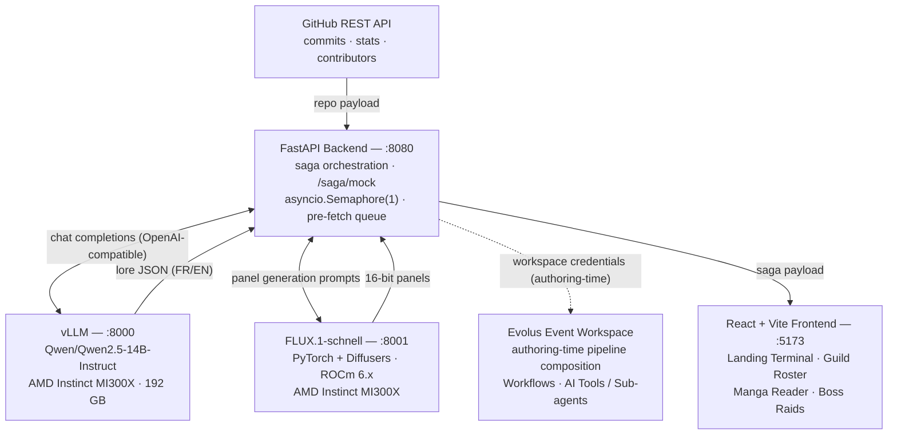

# RepoTales — Architecture

## Runtime topology

## Components

| Component | Responsibility | Key files |
|---|---|---|
| Backend API | Routes, validation, background tasks, health/config report | `backend/main.py`, `backend/routers/saga.py`, `backend/routers/image.py` |
| GitHub ingestion | Public repo parsing, commit list, per-commit stats, bot filtering, rate-limit handling | `backend/services/github_service.py` |
| Narrative engine | Qwen 2.5 prompting (FR/EN), JSON repair, validated fallback saga | `backend/services/amd_service.py` |
| Visual engine | FLUX.1-schnell calls, SHA-256 seeds, disk/memory cache, retry policy, circuit breaker, pre-generation tiers | `backend/services/image_service.py` |
| Frontend | Four game screens, view-model normalization, i18n, Web Audio chiptune | `frontend/src/` |
| Container stack | Backend on 8080, Nginx-served frontend on 5173, `/api` reverse proxy | `docker-compose.yml`, `frontend/nginx.conf` |

## Saga pipeline

1. **Ingest** — `POST /saga/generate` parses `repo_url`, fetches the N latest commits (default 15, max 50), then enriches each with additions / deletions / files changed.
2. **Narrate** — `AMDService.generate_saga()` prompts Qwen 2.5 with the commit payload plus the language directive, repairs malformed JSON when needed, and validates the result against `SagaPayload`.
3. **Illustrate** — `attach_artwork()` computes deterministic SHA-256 seeds per character, panel, and boss sprite and writes `/api/image-proxy` URLs into the payload. No network call happens here: the browser fetches each image lazily, and the proxy serializes upstream FLUX requests with `asyncio.Semaphore(1)`, retries transient failures once, and caches PNGs in memory and on disk.
4. **Pre-generate** — after the JSON response, `pregenerate_saga_artwork()` warms squad sprites, the first page, then the remaining chapters and boss panels (gated by `AMD_IMAGE_PREGENERATE`).
5. **Render** — the frontend maps the raw payload through `buildSagaView()` into the roster / manga / boss contract and renders the four screens.

## Boss raid

Combat is client-side in `BossEventModal.jsx`. Boss HP is derived as `5000 + 1000 × chapters`, the level as `hero level + 10` (max 99), and the three moves deal 32% / 16% / 24% of max HP with AP ratings of 2 / 1 / 2. AP is a move rating, not a spent resource: a move with `ap >= 2` resolves as a critical hit. Victory is detected immediately when HP reaches zero; no network round-trip is required per turn.

## Environment

| Variable | Used by | Purpose |
|---|---|---|
| `PORT` | Compose | Host port published for the backend |
| `VLLM_BASE_URL` / `AMD_LLM_BASE_URL` | Backend | OpenAI-compatible vLLM base URL |
| `VLLM_MODEL` / `AMD_MODEL_NAME` | Backend | Served model identifier |
| `FLUX_BASE_URL` / `AMD_IMAGE_SERVER_URL` | Backend | FLUX server base URL (a bare host gets `/generate-image`) |
| `AMD_IMAGE_TIMEOUT` | Backend | Per-image upstream read timeout (seconds) |
| `AMD_IMAGE_CONNECT_TIMEOUT` | Backend | TCP connect timeout; short so a dead FLUX host fails fast (default 4 s) |
| `AMD_IMAGE_QUEUE_TIMEOUT` | Backend | Max wait for the single FLUX slot before returning 503 (default 30 s) |
| `AMD_IMAGE_CIRCUIT_THRESHOLD` / `AMD_IMAGE_CIRCUIT_COOLDOWN` | Backend | Consecutive transient failures (timeout / 5xx) before the circuit opens, and how long it stays open (default 2 / 30 s). A connection-level failure (host down) opens it immediately |
| `GITHUB_TOKEN` | Backend | Optional; raises GitHub REST quota from 60 to 5 000 req/h |
| `GITHUB_CACHE_TTL` | Backend | Reuse a repo's enriched commits for repeated generations (default 300 s) |
| `GITHUB_STATS_TIMEOUT` | Backend | Deadline for the per-commit stats fan-out (default 12 s) |
| `GITHUB_MAX_CONCURRENCY` | Backend | Parallel GitHub requests during stats enrichment (default 8) |
| `EVOLUS_WORKSPACE_ID`, `EVOLUS_API_KEY` | Compose / health | Workspace configuration hooks |
| `CORS_ORIGINS` | Backend | Comma-separated allowed origins (default `*`) |

Real environment variables always win over `.env` files (`load_dotenv(..., override=False)`). The backend loads the repository-root `.env` first, then `backend/.env`, so both the documented `cp .env.example .env` manual run and the Compose stack resolve the same keys.
